# Gerenciador de Tarefas Web

Sistema web para organizar tarefas, feito com **Spring MVC**, **Thymeleaf** e **Spring Data JPA** sobre um
banco **PostgreSQL**. É a versão web do [Gerenciador de Tarefas desktop em Java Swing](https://github.com/MarcosJr62/GerenciadorTarefas_JavaSwing),
desenvolvido antes pelo grupo, e reaproveita o modelo de dados e as regras de negócio daquele projeto.

> **1ª etapa:** tema, protótipos de tela, diagrama de classes e MER (este README).
> **Sistema:** implementado e funcionando. Veja as [telas do sistema](#telas-do-sistema) e [como executar](#como-executar).
>
> 🔗 **[Abrir os protótipos de tela](https://guilhermekarnopp.github.io/GerenciadorTarefas_SpringWeb/)**

---

## Tema

**Gestão de tarefas pessoais.** Cada pessoa cria uma conta e cadastra as próprias tarefas, com título, descrição,
prazo, categoria, prioridade e status. Na tela principal ela pesquisa, filtra e ordena as tarefas, conclui uma
tarefa com um clique e vê quais estão atrasadas.

O sistema tem dois perfis de acesso:

- **Usuário:** mantém as próprias tarefas e categorias e o próprio cadastro. Nunca vê os dados de outra pessoa.
- **Administrador:** faz tudo o que o usuário faz e também mantém os cadastros que valem para todos
  (status e prioridades) e as contas de usuário.

## Funcionalidades

**Usuário**

- Criar conta, entrar e sair.
- Cadastrar, editar, excluir e listar tarefas.
- Pesquisar tarefas por texto, filtrar por status, prioridade e categoria, ordenar e paginar a lista.
- Concluir uma tarefa com um clique e ver em destaque as tarefas atrasadas.
- Cadastrar, editar, excluir e listar as próprias categorias.
- Editar os próprios dados, trocar a senha e excluir a conta.

**Administrador**

- Cadastrar, editar, excluir e listar usuários, inclusive desbloquear um login travado por senhas erradas.
- Cadastrar, editar, excluir e listar status.
- Cadastrar, editar, excluir e listar prioridades.

## Tabelas e CRUDs

O sistema manipula **5 tabelas**, e todas têm telas de cadastro, edição, exclusão e listagem:

| Tabela       | O que guarda                                        | Quem mantém   |
|--------------|-----------------------------------------------------|---------------|
| `usuario`    | Contas de acesso, perfil e controle de bloqueio do login | Administrador (e cada usuário, o próprio cadastro) |
| `tarefa`     | As tarefas de cada usuário                          | Usuário (só as dele) |
| `categoria`  | Categorias criadas por cada usuário                 | Usuário (só as dele) |
| `status`     | Situações da tarefa: Pendente, Em andamento, Concluída | Administrador |
| `prioridade` | Níveis de urgência: Alta, Média, Baixa              | Administrador |

## Tecnologias

- Java 21 ou superior e Maven (o projeto traz o Maven Wrapper, não precisa instalar)
- Spring Boot 4 com **Spring MVC**, **Thymeleaf** e **Spring Data JPA**
- Spring Security para login, perfis de acesso e proteção CSRF dos formulários
- Bean Validation para validar os formulários no servidor
- PostgreSQL, com as tabelas criadas pelo Flyway
- Bootstrap 5 e Bootstrap Icons nas telas, servidos pelo próprio sistema (WebJars)
- JUnit, Mockito e Testcontainers nos testes

---

## Protótipos de tela

🔗 **[Abrir os protótipos navegáveis](https://guilhermekarnopp.github.io/GerenciadorTarefas_SpringWeb/)**
(código em [`docs/`](docs/))

Os protótipos são páginas HTML com Bootstrap e dados fictícios, publicadas pelo GitHub Pages. Dá para navegar entre
elas pelos menus e botões, e cada tela tem no rodapé uma nota com a rota prevista no Spring MVC e as regras que
ela segue. Para abrir sem internet, basta abrir `docs/index.html` no navegador.

Clique em uma imagem para abrir a tela correspondente.

### Acesso

<table>
<tr>
<td width="50%"><a href="https://guilhermekarnopp.github.io/GerenciadorTarefas_SpringWeb/login.html">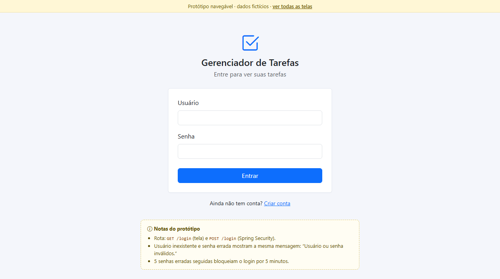</a><br><b>Login</b></td>
<td width="50%"><a href="https://guilhermekarnopp.github.io/GerenciadorTarefas_SpringWeb/criar-conta.html">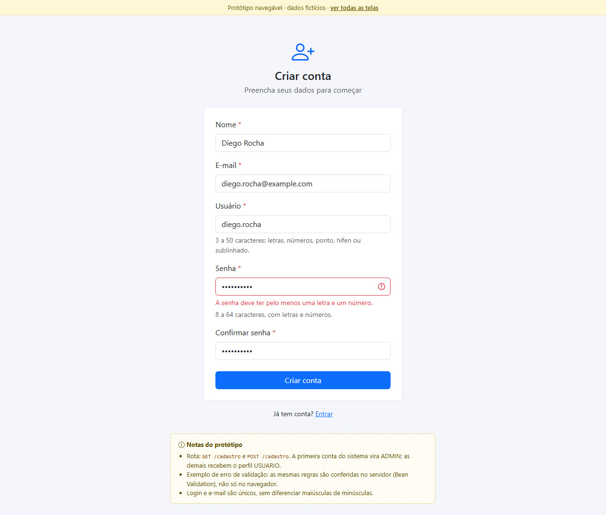</a><br><b>Criar conta</b> (com exemplo de erro de validação)</td>
</tr>
</table>

### Tarefas

<a href="https://guilhermekarnopp.github.io/GerenciadorTarefas_SpringWeb/tarefas.html">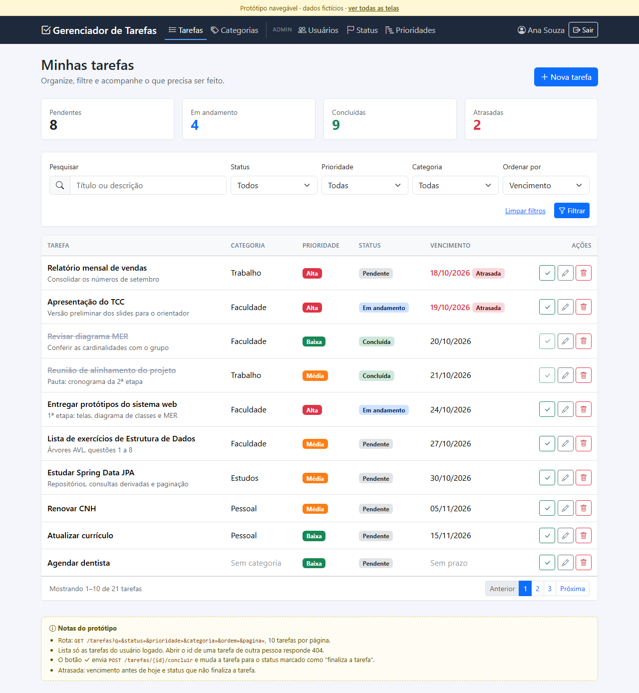</a>

**Listagem de tarefas:** tela principal, com resumo, pesquisa, filtros, ordenação e paginação.

<table>
<tr>
<td width="50%"><a href="https://guilhermekarnopp.github.io/GerenciadorTarefas_SpringWeb/tarefa-form.html">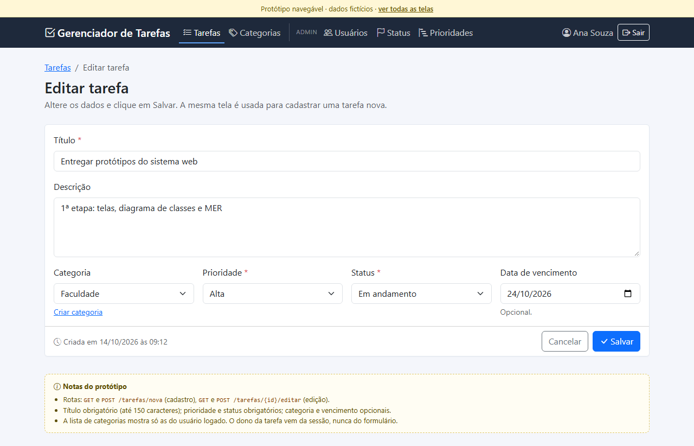</a><br><b>Cadastro / edição de tarefa</b></td>
<td width="50%"><a href="https://guilhermekarnopp.github.io/GerenciadorTarefas_SpringWeb/tarefa-excluir.html">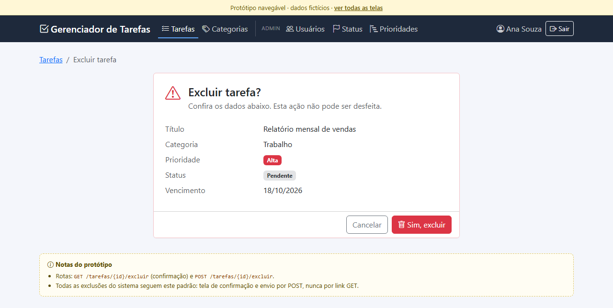</a><br><b>Exclusão de tarefa</b></td>
</tr>
</table>

### Categorias

<table>
<tr>
<td width="50%"><a href="https://guilhermekarnopp.github.io/GerenciadorTarefas_SpringWeb/categorias.html">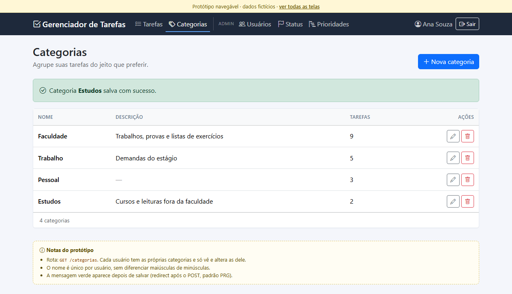</a><br><b>Listagem de categorias</b></td>
<td width="50%"><a href="https://guilhermekarnopp.github.io/GerenciadorTarefas_SpringWeb/categoria-form.html">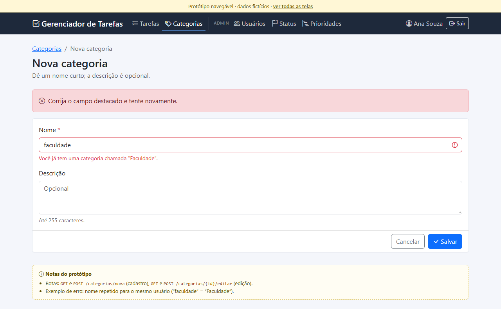</a><br><b>Cadastro / edição de categoria</b> (com exemplo de nome repetido)</td>
</tr>
<tr>
<td width="50%"><a href="https://guilhermekarnopp.github.io/GerenciadorTarefas_SpringWeb/categoria-excluir.html">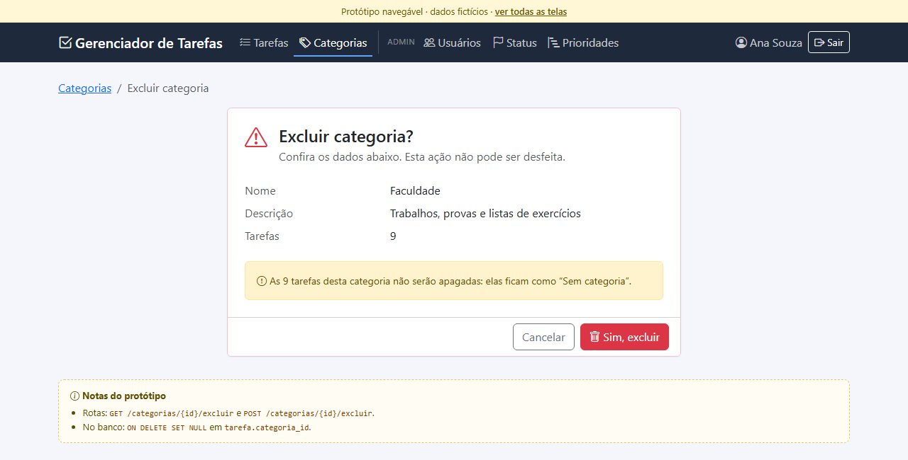</a><br><b>Exclusão de categoria</b></td>
<td width="50%"></td>
</tr>
</table>

### Administração: usuários

<table>
<tr>
<td width="50%"><a href="https://guilhermekarnopp.github.io/GerenciadorTarefas_SpringWeb/usuarios.html">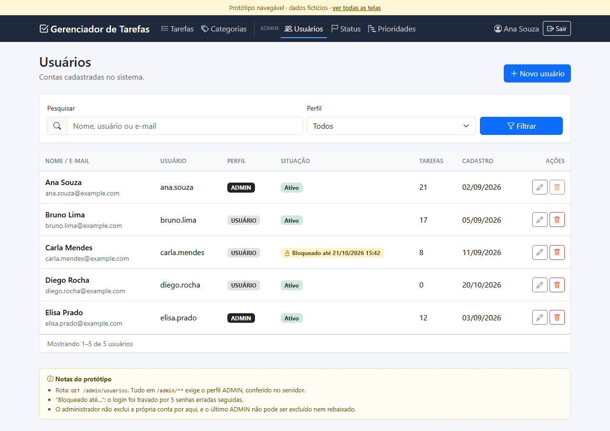</a><br><b>Listagem de usuários</b></td>
<td width="50%"><a href="https://guilhermekarnopp.github.io/GerenciadorTarefas_SpringWeb/usuario-form.html">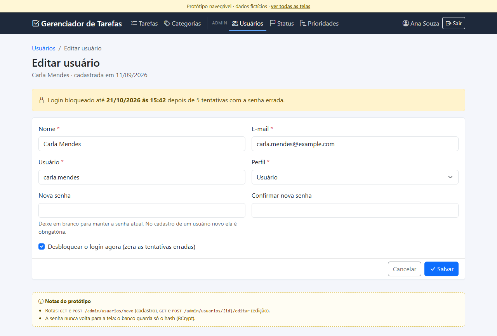</a><br><b>Cadastro / edição de usuário</b></td>
</tr>
<tr>
<td width="50%"><a href="https://guilhermekarnopp.github.io/GerenciadorTarefas_SpringWeb/usuario-excluir.html">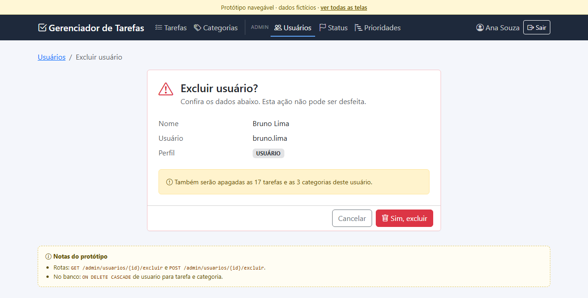</a><br><b>Exclusão de usuário</b></td>
<td width="50%"></td>
</tr>
</table>

### Administração: status

<table>
<tr>
<td width="50%"><a href="https://guilhermekarnopp.github.io/GerenciadorTarefas_SpringWeb/status.html">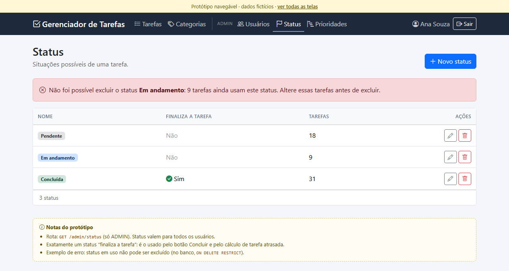</a><br><b>Listagem de status</b> (com exemplo de exclusão recusada)</td>
<td width="50%"><a href="https://guilhermekarnopp.github.io/GerenciadorTarefas_SpringWeb/status-form.html">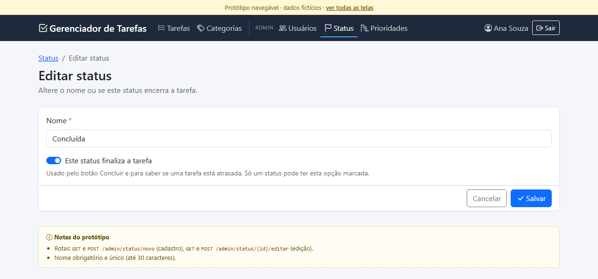</a><br><b>Cadastro / edição de status</b></td>
</tr>
<tr>
<td width="50%"><a href="https://guilhermekarnopp.github.io/GerenciadorTarefas_SpringWeb/status-excluir.html">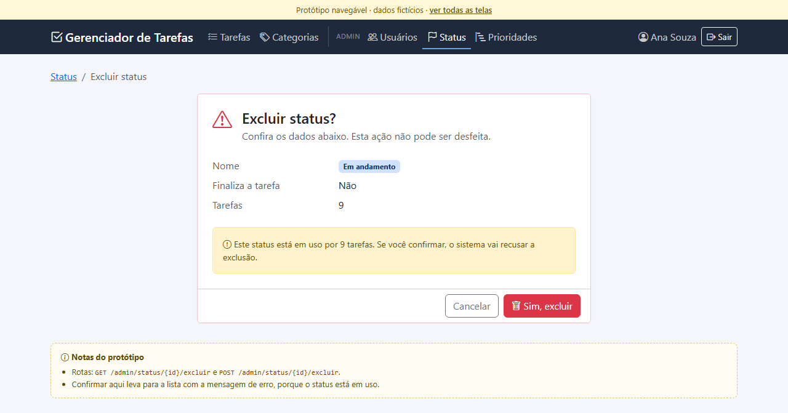</a><br><b>Exclusão de status</b></td>
<td width="50%"></td>
</tr>
</table>

### Administração: prioridades

<table>
<tr>
<td width="50%"><a href="https://guilhermekarnopp.github.io/GerenciadorTarefas_SpringWeb/prioridades.html">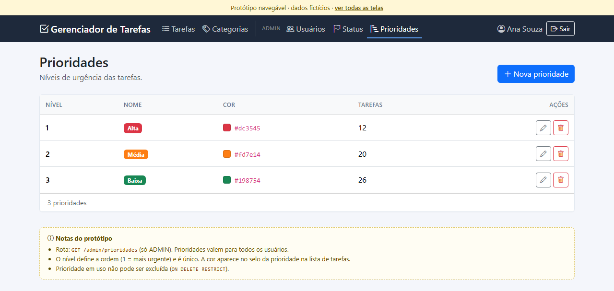</a><br><b>Listagem de prioridades</b></td>
<td width="50%"><a href="https://guilhermekarnopp.github.io/GerenciadorTarefas_SpringWeb/prioridade-form.html">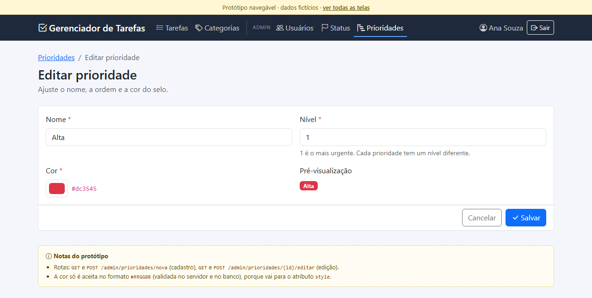</a><br><b>Cadastro / edição de prioridade</b></td>
</tr>
<tr>
<td width="50%"><a href="https://guilhermekarnopp.github.io/GerenciadorTarefas_SpringWeb/prioridade-excluir.html">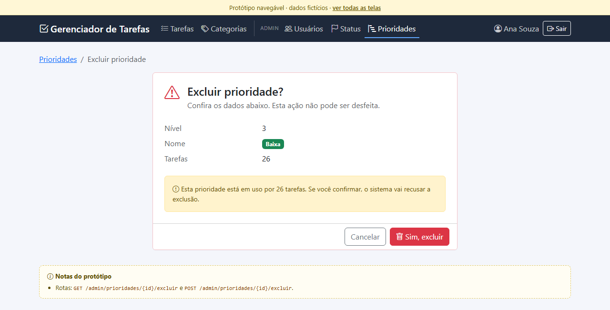</a><br><b>Exclusão de prioridade</b></td>
<td width="50%"></td>
</tr>
</table>

### Conta

<table>
<tr>
<td width="50%"><a href="https://guilhermekarnopp.github.io/GerenciadorTarefas_SpringWeb/perfil.html">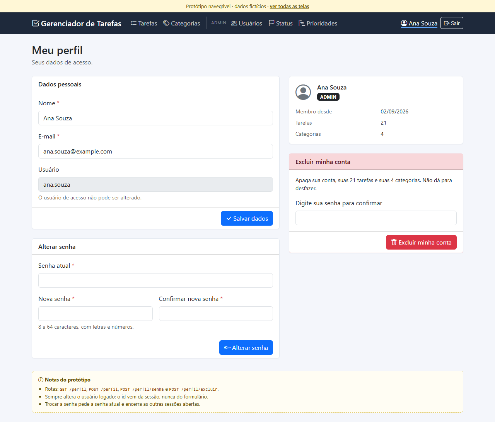</a><br><b>Meu perfil:</b> editar dados, trocar senha e excluir a conta</td>
<td width="50%"></td>
</tr>
</table>

---

## Diagrama de classes

Entidades do sistema, que viram classes `@Entity` do JPA. Getters, setters e construtores foram omitidos.

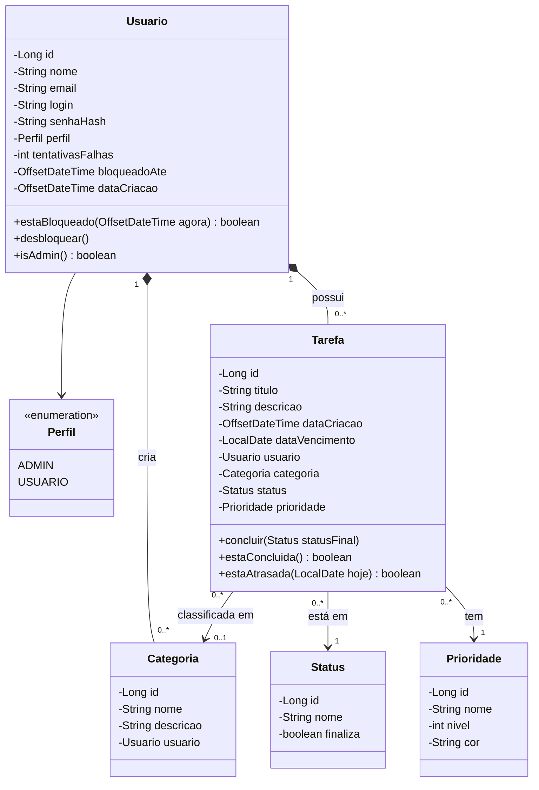

- **Usuario** guarda apenas o hash da senha (BCrypt, pelo `PasswordEncoder` do Spring Security), nunca a senha.
  `tentativasFalhas` e `bloqueadoAte` bloqueiam o login por 5 minutos depois de 5 senhas erradas seguidas
  (a contagem é feita com um `UPDATE` atômico no `UsuarioRepository`).
- **Tarefa** e **Categoria** são compostas pelo **Usuario**: pertencem a um único usuário e são apagadas junto com ele.
- **Tarefa** aponta para **Categoria**, **Status** e **Prioridade** (`@ManyToOne`). A categoria é opcional.
- `Tarefa.concluir(...)` troca o status pelo status que tem `finaliza = true`.
  `Tarefa.estaAtrasada(hoje)` é verdadeiro quando o vencimento já passou e o status ainda não finaliza a tarefa.
- **Prioridade.nivel** define a ordem de urgência (1 = mais urgente), e **Prioridade.cor** é a cor do selo na tela.

## Modelo Entidade-Relacionamento (MER)

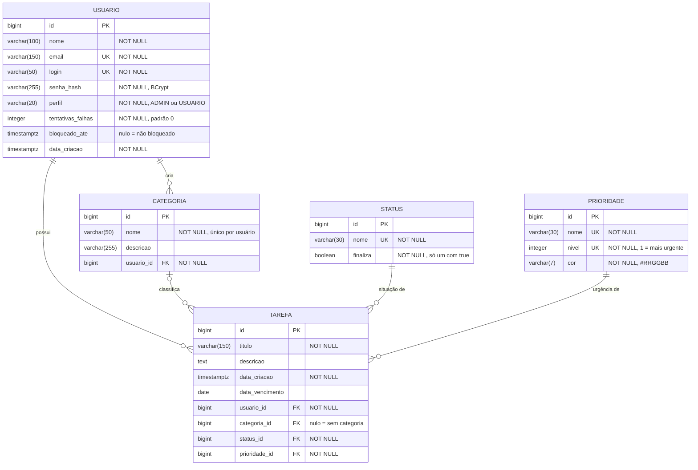

### Relacionamentos

| Relacionamento         | Cardinalidade | Ao excluir o registro "pai"                                 |
|------------------------|---------------|-------------------------------------------------------------|
| USUARIO → TAREFA       | 1 : N         | As tarefas do usuário são apagadas (`ON DELETE CASCADE`)    |
| USUARIO → CATEGORIA    | 1 : N         | As categorias do usuário são apagadas (`ON DELETE CASCADE`) |
| CATEGORIA → TAREFA     | 0..1 : N      | As tarefas ficam sem categoria (`ON DELETE SET NULL (categoria_id)`) |
| STATUS → TAREFA        | 1 : N         | Não permite excluir status em uso (`ON DELETE RESTRICT`)    |
| PRIORIDADE → TAREFA    | 1 : N         | Não permite excluir prioridade em uso (`ON DELETE RESTRICT`) |

### Regras garantidas pelo banco

- `login` e `email` são únicos sem diferenciar maiúsculas de minúsculas (índice único em `lower(...)`).
- O nome da categoria é único **por usuário**: índice único em `(usuario_id, lower(nome))`.
- A categoria de uma tarefa é sempre do mesmo dono da tarefa: a chave estrangeira é composta,
  `(categoria_id, usuario_id)` → `categoria (id, usuario_id)`.
- Só um status pode ter `finaliza = true` (índice único parcial em `finaliza WHERE finaliza`).
- `perfil` aceita apenas `ADMIN` ou `USUARIO`, e `cor` apenas o formato `#RRGGBB` (`CHECK`).
- Título, nome e login não podem ser só espaços (`CHECK (btrim(...) <> '')`).

---

## Telas do sistema

O sistema implementado segue os protótipos. Abaixo, telas reais com dados de exemplo.

<a href="docs/img/sistema/tarefas.png">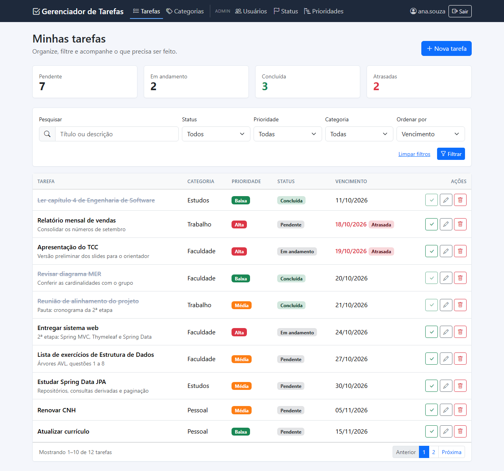</a>

**Minhas tarefas:** os cartões contam as tarefas por status, a tabela vem do banco com filtros, ordenação e
paginação, e as tarefas atrasadas aparecem em destaque.

<table>
<tr>
<td width="50%"><a href="docs/img/sistema/usuarios.png">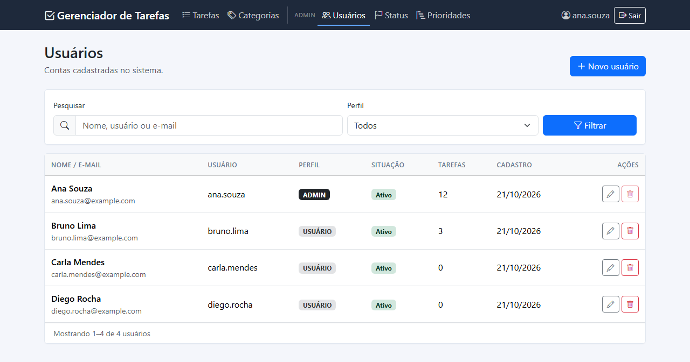</a><br><b>Usuários</b> (só para administradores)</td>
<td width="50%"><a href="docs/img/sistema/perfil.png">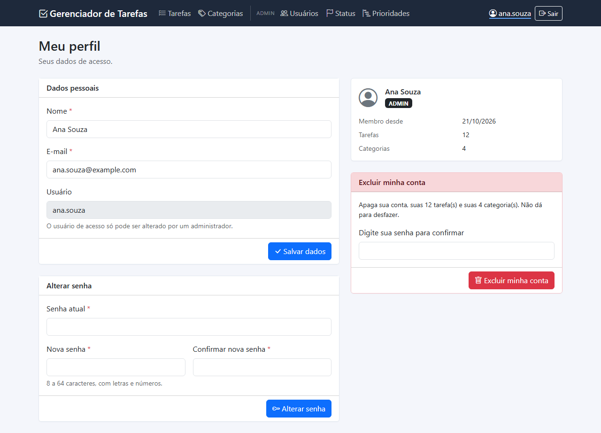</a><br><b>Meu perfil</b></td>
</tr>
<tr>
<td width="50%"><a href="docs/img/sistema/acesso-negado.png">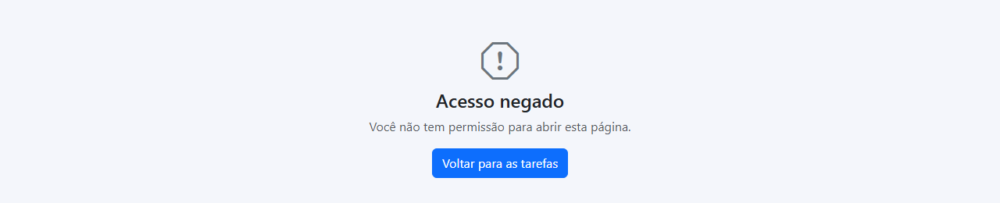</a><br><b>Acesso negado:</b> usuário comum tentando abrir a área de administração</td>
<td width="50%"></td>
</tr>
</table>

## Como executar

Precisa do **JDK 21 ou superior** e do **PostgreSQL 16 ou mais novo** instalados. O Maven não precisa ser instalado:
o projeto usa o Maven Wrapper (`mvnw`).

**1. Crie o banco (só na primeira vez).** Na raiz do repositório:

```powershell
powershell -ExecutionPolicy Bypass -File banco\setup-banco.ps1
```

O script pede a senha do usuário `postgres` (definida na instalação do PostgreSQL) e uma senha nova para o sistema.
Ele cria o banco `gerenciador_web` e guarda a senha na variável `WEB_DB_PASSWORD` do Windows. **As tabelas não são
criadas pelo script:** o próprio sistema cria tudo (Flyway) na primeira vez que sobe.

**2. Rode o sistema:**

```powershell
powershell -ExecutionPolicy Bypass -File executar.ps1
```

Depois abra **http://localhost:8080**. Pelo IntelliJ, também dá para rodar a classe `GerenciadorTarefasWebApplication`
(reabra o IntelliJ depois do passo 1 para ele enxergar a variável `WEB_DB_PASSWORD`).

**3. Crie a primeira conta** em "Criar conta". **A primeira conta do sistema vira administradora**; as seguintes são
de usuários comuns, e o administrador pode promover outras contas na tela Usuários.

> A senha do banco nunca fica no código: o `application.properties` lê `WEB_DB_PASSWORD`. Para usar outro banco,
> defina também `WEB_DB_URL` e `WEB_DB_USER`.

## Estrutura do código

```
src/main/java/br/com/gerenciador/
├── model/        entidades JPA (Usuario, Tarefa, Categoria, Status, Prioridade) e o enum Perfil
├── repository/   interfaces do Spring Data JPA (consultas sempre filtradas pelo dono)
├── dto/          objetos dos formulários e filtros, com as validações do Bean Validation
├── service/      regras de negócio (as mesmas da versão desktop, adaptadas para a web)
├── security/     Spring Security: login, bloqueio por tentativas, perfis e sessões
└── controller/   controllers do Spring MVC (admin/ para a área do administrador)
src/main/resources/
├── db/migration/ scripts do Flyway que criam as tabelas e os dados iniciais
├── templates/    telas Thymeleaf (feitas a partir dos protótipos de docs/)
└── static/css/   estilo das telas
```

## Testes

```powershell
.\mvnw.cmd test
```

São 41 testes:

- **Unitários:** regras de senha, tarefa atrasada e conclusão, status finalizador, cadastro de contas e regras do
  administrador.
- **Segurança da web:** login obrigatório, área admin só para ADMIN, token CSRF e dono vindo da sessão.
- **Banco de dados:** rodam num PostgreSQL de verdade criado pelo Testcontainers, e conferem as migrações, os filtros
  de busca, as chaves estrangeiras e o bloqueio de login. Precisam do Docker aberto; sem ele, são pulados.

## Segurança

- Senhas guardadas só como hash BCrypt. Login inexistente e senha errada mostram a mesma mensagem, e 5 erros
  seguidos bloqueiam o login por 5 minutos. A troca de senha e a exclusão de conta também contam as tentativas.
- Toda tarefa e categoria é buscada pelo id **e** pelo dono logado. Abrir o registro de outra pessoa responde 404, e a
  área `/admin/**` exige o perfil ADMIN, conferido no servidor.
- Formulários com token CSRF, exclusões só por POST, consultas parametrizadas e telas que escapam o texto (Thymeleaf).
- Trocar a senha encerra as outras sessões abertas da conta. Mudar o perfil ou excluir um usuário encerra as sessões
  dele.
- Cabeçalhos de segurança (Content-Security-Policy, X-Frame-Options e outros) e páginas de erro sem detalhes técnicos.

---

## O que muda em relação à versão desktop

O modelo de dados é o mesmo do [projeto em Java Swing](https://github.com/MarcosJr62/GerenciadorTarefas_JavaSwing),
com os ajustes necessários para um sistema web com vários usuários ao mesmo tempo:

- **Categorias por usuário.** No desktop as categorias eram compartilhadas por todos. Na web isso deixaria uma
  pessoa editar ou apagar a categoria de outra, então cada categoria passa a ter um dono (`categoria.usuario_id`).
- **Perfil de acesso** (`usuario.perfil`). Status, prioridades e usuários ganham telas de manutenção, que só o
  administrador acessa.
- **`status.finaliza`.** O desktop encontrava o status de conclusão pelo nome "Concluída". Como agora o nome pode ser
  editado, um campo indica qual status encerra a tarefa.
- **`prioridade.nivel` e `prioridade.cor`.** Ordenam as prioridades por urgência (e não por ordem alfabética) e
  definem a cor do selo na lista de tarefas.
- **Senha com o Spring Security** (BCrypt) no lugar do hash PBKDF2 feito à mão.

## Etapas

- [x] **1ª etapa:** tema, protótipos de tela, diagrama de classes e MER
- [x] Implementação com Spring MVC, Thymeleaf e Spring Data JPA
